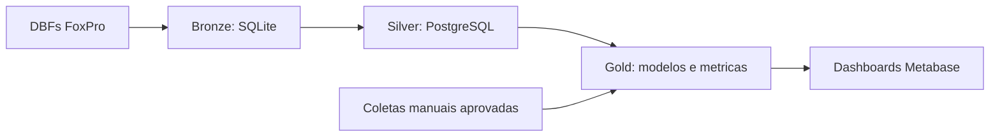

# ETL FoxPro DBF para Data Warehouse Veterinario

Pipeline local para extrair dados de um ERP FoxPro/DBF, criar uma camada Bronze em SQLite e carregar a camada Silver no PostgreSQL. O destino planejado e um DW com camada Gold consultada pelo Metabase.

## Arquitetura resumida



Consulte [a arquitetura detalhada](docs/architecture.md), [as camadas de dados](docs/data-layers.md), [a operacao local](docs/operations.md) e [o roteiro do projeto](docs/roadmap.md).

## Inicio rapido

1. Crie e ative um ambiente virtual Python.
2. Instale dependencias: `python -m pip install -r requirements.txt`.
3. Copie `.env.example` para `.env` e ajuste a conexao PostgreSQL local.
4. Inicie o banco: `docker compose up -d`.
5. Coloque os DBFs em `dados_extraidos/`.
6. Gere a Bronze: `python dbf_to_sqlite.py`.
7. Carregue a Silver: `python sqlite_to_postgres.py`.

O caminho direto `python dbf_to_postgres.py` e mantido para comparacao e diagnostico. O fluxo recomendado e DBF para SQLite e depois SQLite para PostgreSQL.

## Estrutura

```text
.
|- dados_extraidos/      # DBFs de origem, local e ignorado pelo Git
|- data/bronze/          # SQLite gerado, ignorado pelo Git
|- reports/              # CSVs e log gerados, ignorados pelo Git
|- consultoria/          # Requisitos BSC, catalogos e coletas manuais
|- docs/                 # Arquitetura, operacao, camadas e roteiro
|- sql/                  # Scripts SQL versionados
|- templates/            # Modelos reutilizaveis
|- dbf_to_sqlite.py      # Extracao Bronze
|- sqlite_to_postgres.py # Carga Silver recomendada
`- docker-compose.yml    # PostgreSQL local
```

## Seguranca e versionamento

O Git versiona codigo, SQL, documentacao e modelos. DBFs, `vet.db`, relatorios gerados, `.env` e ambiente virtual sao excluidos por `.gitignore`. Nunca registre credenciais, dados de tutores ou prontuarios no repositorio.

## Estado atual

- Bronze DBF para SQLite: validada.
- Silver SQLite para PostgreSQL: validada.
- Camada Gold, Metabase e Airflow: planejados, ainda nao implementados.
- Requisitos de metricas: catalogados em `consultoria/`.

O estado vivo, decisoes e proximas aprovacoes estao em [PROJECT_CONTEXT.md](PROJECT_CONTEXT.md).