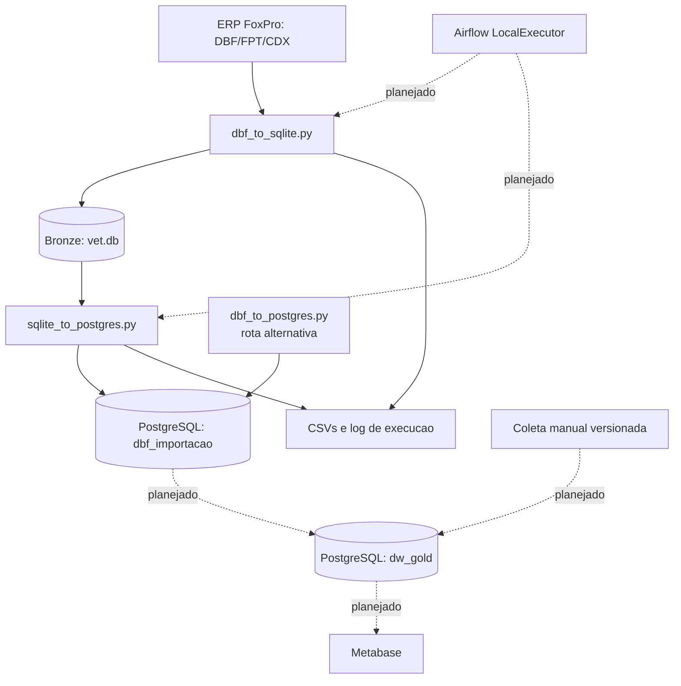
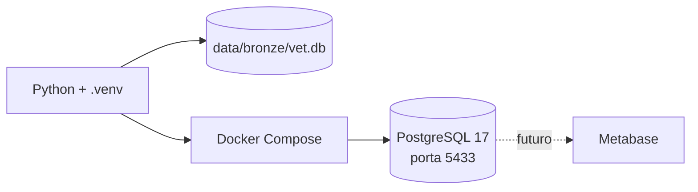

# Arquitetura Tecnica

## Componentes atuais

## Responsabilidades

| Componente | Responsabilidade | Estado |
| --- | --- | --- |
| `dbf_to_sqlite.py` | Le DBFs tolerando dados invalidos, gera uma tabela SQLite por arquivo e valida contagens. | Validado |
| `sqlite_to_postgres.py` | Recria o schema Silver e copia as tabelas SQLite por `asyncpg` COPY binario. | Validado |
| `dbf_to_postgres.py` | Carga direta concorrente para comparacao e diagnostico. | Alternativo |
| `config_sistema.py` | Centraliza entrada, saidas e concorrencia. | Ativo |
| `config_banco.py` | Le `.env` e fornece parametros PostgreSQL. | Ativo |
| `relatorios.py` | Registra tempos e resultado por tabela. | Ativo |
| `sql/coleta_manual_metricas.sql` | Define a estrutura futura de fatos manuais no Gold. | Validado em transacao revertida |

## Implantacao local

O Compose atual possui somente PostgreSQL. Airflow, Metabase e o schema Gold devem ser adicionados apenas apos aprovacao de seus contratos de dados.

## Fronteiras de dados

- **Origem**: `dados_extraidos/` e excluida do Git por conter exportacoes do ERP.
- **Bronze**: representacao local bruta em SQLite, criada em `data/bronze/vet.db`.
- **Silver**: espelho estruturado no schema PostgreSQL `dbf_importacao`.
- **Gold**: modelos de negocio, metricas e agregados; ainda nao implementada.
- **Manual**: metas, baselines, pesquisas e PDCA que nao podem ser inferidos de DBFs.

## Riscos conhecidos

- DBFs podem conter campos com codificacao, datas, logicos ou memos invalidos; a Bronze registra alertas e preserva a carga quando possivel.
- Nem todos os eventos operacionais possuem status confiavel na base atual; faltas, cancelamentos e varios indicadores de qualidade exigem captura manual ou ajuste de origem.
- O carregador Silver remove e recria o schema configurado; ele deve apontar para um schema de carga dedicado, nunca para um banco operacional.